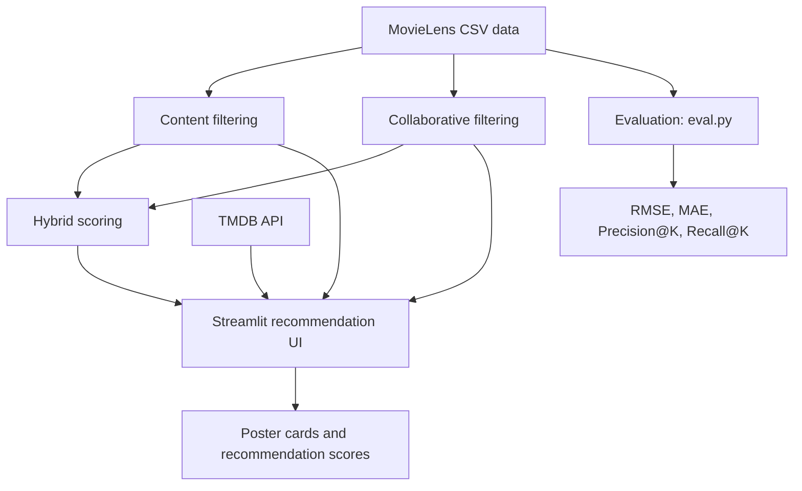

# 🎬 Movie & Content Filtering Engine (Hybrid Recommender System)

An end-to-end Machine Learning Recommender System built with Python, Scikit-learn, Surprise, and Streamlit. This project implements Content-Based Filtering using TF-IDF and Cosine Similarity, Collaborative Filtering using Singular Value Decomposition (SVD) Matrix Factorization, and a weighted Hybrid Recommendation Engine with TMDB dynamic movie poster integration.

---

## 📐 System Architecture & Workflow

The application loads movie metadata and ratings from the MovieLens CSV files
in `data/`. The Streamlit UI sends user selections to the recommendation
modules, which produce ranked results for display as poster cards.



### Content-Based Filtering

`content_based.py` cleans each movie's genre string, transforms genres into
TF-IDF vectors with scikit-learn, and calculates cosine similarity between
movies. Given a reference title, it ranks other titles by similarity.

### Collaborative Filtering

`collaborative.py` trains a Surprise SVD model on user ratings. For a selected
user, it predicts ratings for movies they have not rated and ranks those
recommendations by predicted rating.

### Hybrid Recommendation Engine

The hybrid flow combines content similarity with normalized collaborative
ratings. It joins the recommendation candidates by `movieId` and ranks them
using the adjustable content weight:

```text
hybrid_score = content_weight * similarity_score
             + (1 - content_weight) * normalized_rating
```

A content weight of `1.0` favors content similarity; `0.0` favors predicted
ratings. The app displays up to five or ten recommendations, depending on the
selected result count.

### Poster Integration

The app maps `movieId` to `tmdbId` using `data/links.csv`, requests each
movie's poster path from TMDB, and displays the returned image. If the TMDB
request fails, no poster is listed, or `TMDB_API_KEY` is not configured, the
app uses a placeholder image instead.

---

## ✨ Features

- Content-based recommendations from a selected movie.
- Collaborative recommendations from a selected user ID.
- Hybrid recommendations with an adjustable content/collaborative weight.
- Five- or ten-result recommendation selection.
- TMDB movie posters with a placeholder fallback.
- Offline evaluation of rating prediction and top-K ranking metrics.

---

## 🧰 Requirements

- Python 3
- `pip`
- Internet access to download the dataset and (optionally) retrieve TMDB posters

Project dependencies are listed in `requirements.txt`.

---

## 🚀 Installation & Setup

Run commands from the project root directory.

### Windows (PowerShell)

Create and activate a virtual environment, then install dependencies:

```powershell
py -m venv .venv
.\.venv\Scripts\Activate.ps1
python -m pip install --upgrade pip
pip install -r requirements.txt
```

If PowerShell blocks environment activation, allow it for the current
PowerShell process and activate the environment again:

```powershell
Set-ExecutionPolicy -Scope Process -ExecutionPolicy Bypass
.\.venv\Scripts\Activate.ps1
```

### macOS / Linux

```bash
python3 -m venv .venv
source .venv/bin/activate
python -m pip install --upgrade pip
pip install -r requirements.txt
```

### Download the dataset

The project expects `movies.csv`, `ratings.csv`, and `links.csv` in the
`data/` directory. These files are included in the repository's data directory.
If you need to download or refresh the MovieLens latest-small dataset, run:

```bash
python download_data.py
```

This downloads the dataset archive from GroupLens, extracts its CSV files into
`data/`, and removes the downloaded archive after extraction.

---

## ▶️ Run the Application

From the activated virtual environment, start Streamlit:

```bash
streamlit run app.py
```

Open the local URL printed by Streamlit in your browser. The app provides
Movie-based, User-based, and Hybrid recommendation tabs.

### Configure TMDB posters (optional)

Set a TMDB API key in the environment before starting Streamlit. Do not commit
the key to source control.

PowerShell:

```powershell
$env:TMDB_API_KEY = "your-tmdb-api-key"
streamlit run app.py
```

macOS / Linux:

```bash
export TMDB_API_KEY="your-tmdb-api-key"
streamlit run app.py
```

Without a configured key, recommendations still work and poster slots use the
placeholder image.

---

## 📊 Evaluation

Run the evaluation module from the project root:

```bash
python eval.py
```

The script loads `data/ratings.csv`, makes a reproducible 80/20 train/test
split, trains an SVD model on the training set, and reports RMSE, MAE,
Precision@K, and Recall@K for `K=5` and `K=10`. Ratings of `4.0` or higher are
considered relevant for the top-K metrics.

### Recorded Results

Results from the current MovieLens data and seeded evaluation run:

| Metric | Result |
| --- | ---: |
| RMSE | 0.8807 |
| MAE | 0.6766 |
| Precision@5 | 0.4458 |
| Recall@5 | 0.2263 |
| Precision@10 | 0.3616 |
| Recall@10 | 0.2794 |

Precision and recall are macro-averaged across users, ranking each user's
held-out test ratings by predicted rating. Results may change if the dataset or
evaluation configuration changes.

---

## 🗂️ Project Structure

```text
.
├── app.py                # Streamlit user interface
├── content_based.py      # TF-IDF and cosine-similarity recommendations
├── collaborative.py      # Surprise SVD recommendations
├── eval.py               # Train/test evaluation and metrics
├── download_data.py      # MovieLens dataset downloader
├── requirements.txt      # Python dependencies
└── data/
    ├── links.csv         # MovieLens-to-TMDB ID mapping
    ├── movies.csv        # Movie titles and genres
    └── ratings.csv       # User ratings
```

---

## 🧱 Tech Stack

- **Python** — application and model logic
- **Streamlit** — interactive web interface
- **Scikit-learn** — TF-IDF vectorization and cosine similarity
- **Surprise (scikit-surprise)** — SVD collaborative filtering
- **Pandas** — CSV loading and data manipulation
- **TMDB API** — movie poster metadata

---

## 📄 Data & Attribution

The sample data is from the [MovieLens latest-small dataset](https://grouplens.org/datasets/movielens/latest/).
Movie poster metadata and images are retrieved from [The Movie Database (TMDB)](https://www.themoviedb.org/).
